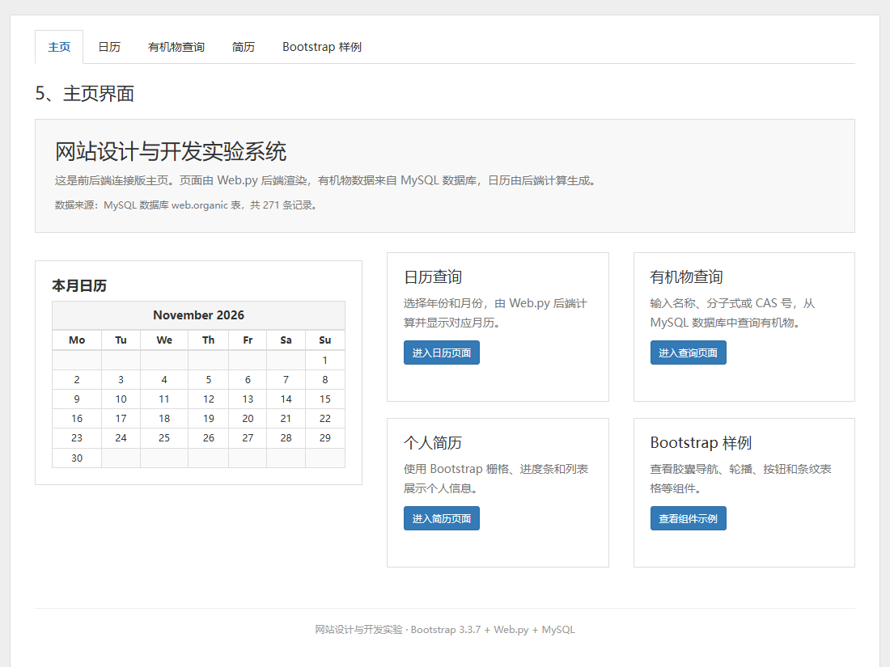
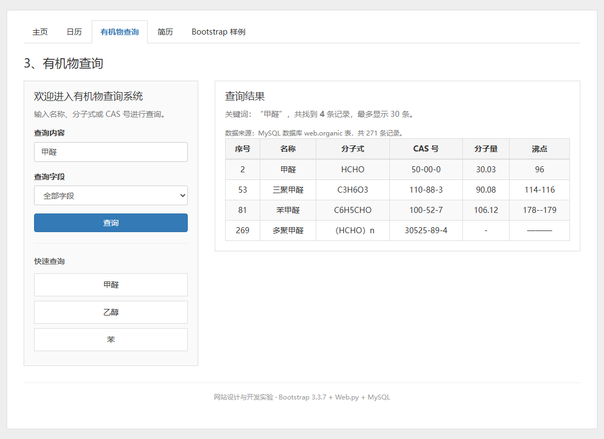
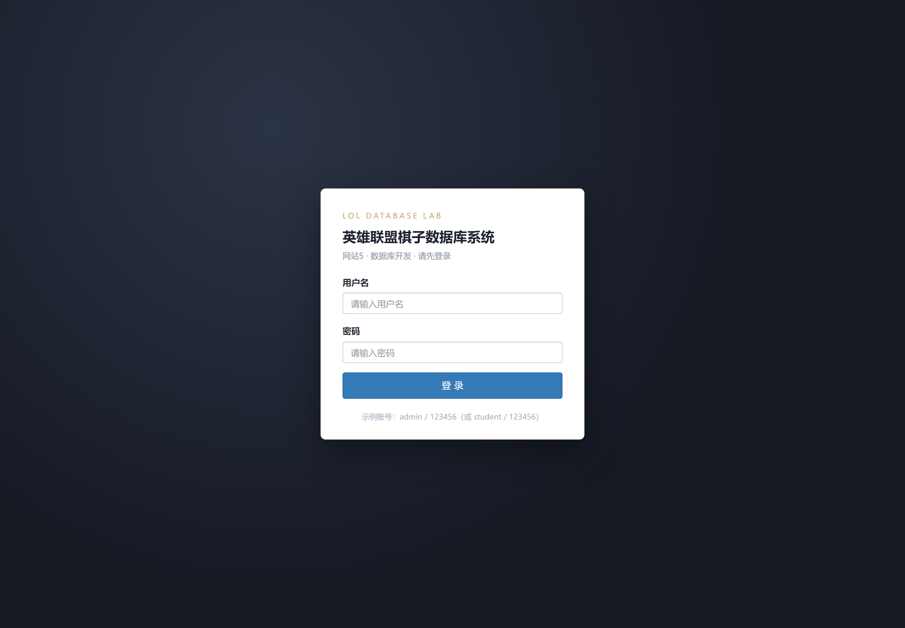
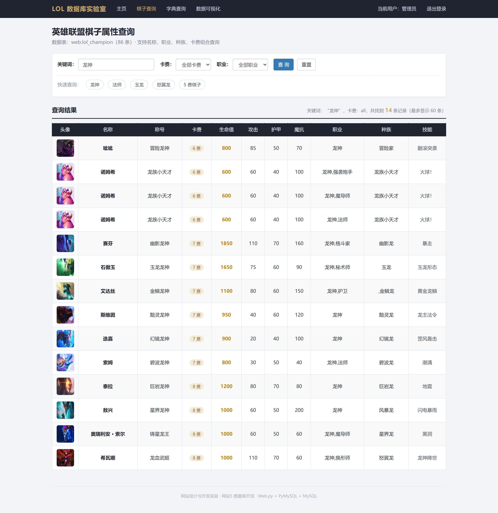
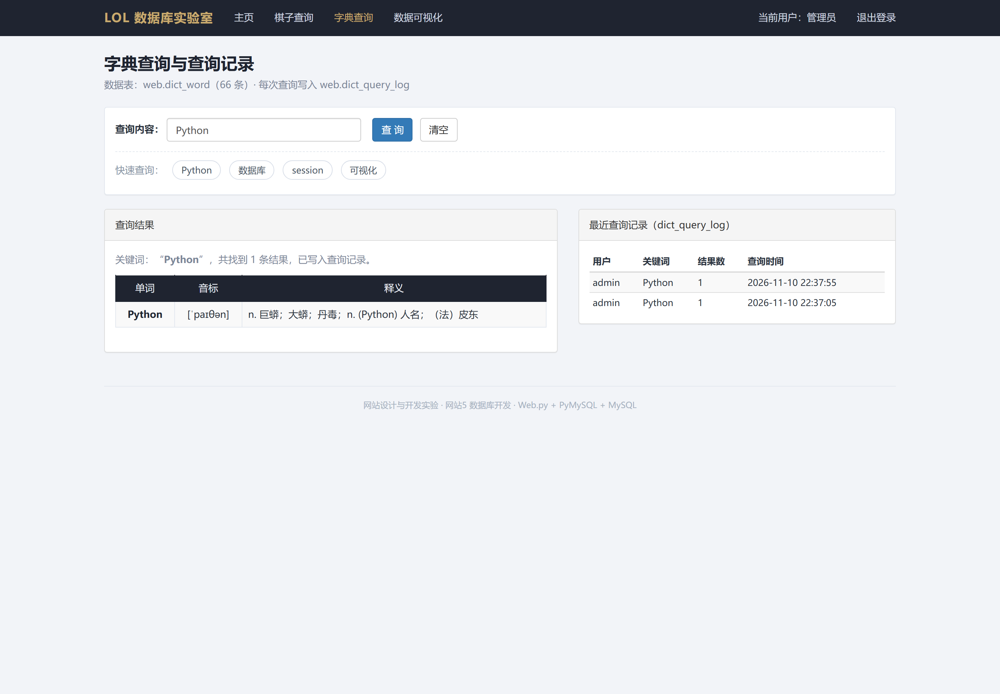
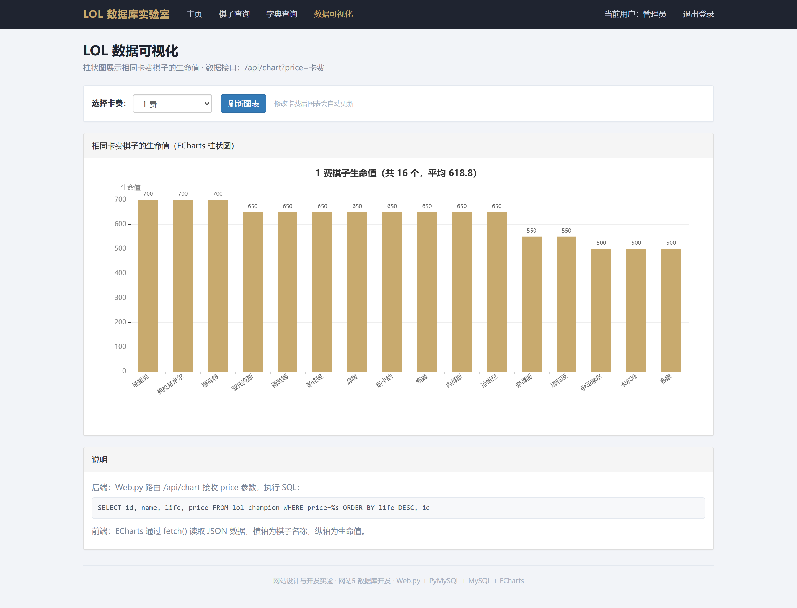

# 网站设计与开发实验合集

《网站设计与开发》课程实验项目，包含两个完整可运行的 Web 应用：

| 项目 | 技术栈 | 主要内容 |
| --- | --- | --- |
| [网站4：前后端连接](网站4-前后端查询) | Python Web.py + PyMySQL + MySQL 8.0 + Bootstrap 3.3.7 | 五页网站；日历由后端计算；有机物查询从 MySQL 读取并渲染表格 |
| [网站5：数据库开发](网站5-数据库开发) | Python Web.py + PyMySQL + MySQL 8.0 + Bootstrap 3.3.7 + ECharts + session | 登录与 session、英雄联盟棋子属性查询、字典查询记录、卡费-生命值柱状图 |

## 演示截图

### 网站4：前后端连接





### 网站5：数据库开发









## 目录结构

```text
website-homework/
├── README.md
├── 网站4-前后端查询/
│   ├── app.py                 Web.py 路由、页面处理类、MySQL 查询
│   ├── config.py              数据库连接配置（密码读环境变量）
│   ├── init_db.py             创建 organic 表并导入 CSV
│   ├── data/organic.csv       有机物数据（271 条）
│   ├── sql/setup.sql          创建数据库 web 和账号 web
│   ├── templates/             主页、日历、有机物查询、简历、Bootstrap 样例
│   ├── static/                Bootstrap / jQuery / 自定义样式
│   └── screenshots/           运行截图
└── 网站5-数据库开发/
    ├── app.py                 登录/session、棋子查询、字典记录、JSON 接口
    ├── config.py              数据库连接配置（密码读环境变量）
    ├── init_db.py             创建 4 张表并导入数据
    ├── data/lol.csv           英雄联盟棋子数据（86 条）
    ├── data/dict_words.csv    字典数据（66 条）
    ├── static/lol/            棋子头像（64 张）
    ├── templates/             登录、主页、棋子查询、字典查询、数据可视化
    ├── screenshots/           运行截图
    └── requirements.txt       Python 依赖
```

## 运行环境

- Windows 10 / 11
- Python 3.8+
- MySQL 8.0（Windows 服务名 `MySQL80`）
- 浏览器：Chrome / Edge

安装依赖（两个项目各自目录下都有 `requirements.txt`）：

```bat
pip install -r "网站4-前后端查询\requirements.txt"
pip install -r "网站5-数据库开发\requirements.txt"
```

## 快速开始

### 1. 启动 MySQL，创建数据库和账号

以 root 身份执行建库脚本（脚本里的 `your_password` 请改成你自己的密码）：

```bat
mysql -uroot -p < "网站4-前后端查询\sql\setup.sql"
```

### 2. 设置数据库密码环境变量

仓库中**不保存数据库密码**，代码通过环境变量 `WEB_DB_PASSWORD` 读取。

PowerShell：

```powershell
$env:WEB_DB_PASSWORD = "你的数据库密码"
```

CMD：

```bat
set WEB_DB_PASSWORD=你的数据库密码
```

### 3. 初始化数据并启动

网站4：

```bat
cd 网站4-前后端查询
python init_db.py
python app.py 8080
```

网站5：

```bat
cd 网站5-数据库开发
python init_db.py
python app.py 8080
```

> 两个项目默认都用 8080 端口，**不要同时启动**；先看一个，停下来再启动另一个。浏览器访问 <http://127.0.0.1:8080/>。

### 4. 网站5 演示账号

- 用户名：`admin`，密码：`123456`
- 或：`student` / `123456`

## 数据库说明

### 网站4

| 表 | 说明 | 数据量 |
| --- | --- | --- |
| `web.organic` | 有机物数据（名称、分子式、CAS 号、分子量、沸点等） | 271 条 |

### 网站5

| 表 | 说明 | 数据量 |
| --- | --- | --- |
| `web.lol_champion` | 英雄联盟棋子属性（卡费、生命值、攻击、护甲、职业、种族、技能等） | 86 条 |
| `web.dict_word` | 字典词条（单词、音标、中文释义） | 66 条 |
| `web.dict_query_log` | 字典查询记录（用户、关键词、结果数、时间） | 查询时写入 |
| `web.sys_user` | 登录用户（用户名、sha256 密码哈希、显示名） | 2 条 |

## 安全说明

- 数据库密码不写入代码和仓库，使用环境变量 `WEB_DB_PASSWORD` 传入；
- 登录密码使用 `sha256` 哈希存储，不保存明文；
- 所有 SQL 查询使用参数化（`%s`）传参，避免 SQL 注入。

## 数据来源与版权

- `organic.csv`、`lol.csv`、`lol图片.zip` 为课程实验数据，仅用于学习交流；
- 英雄联盟棋子名称、图片等版权归腾讯 / Riot Games 所有，本项目仅用于课程学习，不用于商业用途。

## 说明

本项目为课程实验作品，代码结构参考老师提供的 Web.py 通用模板，并在其基础上完成页面、数据库查询、登录 session、查询记录和 ECharts 可视化等功能。
